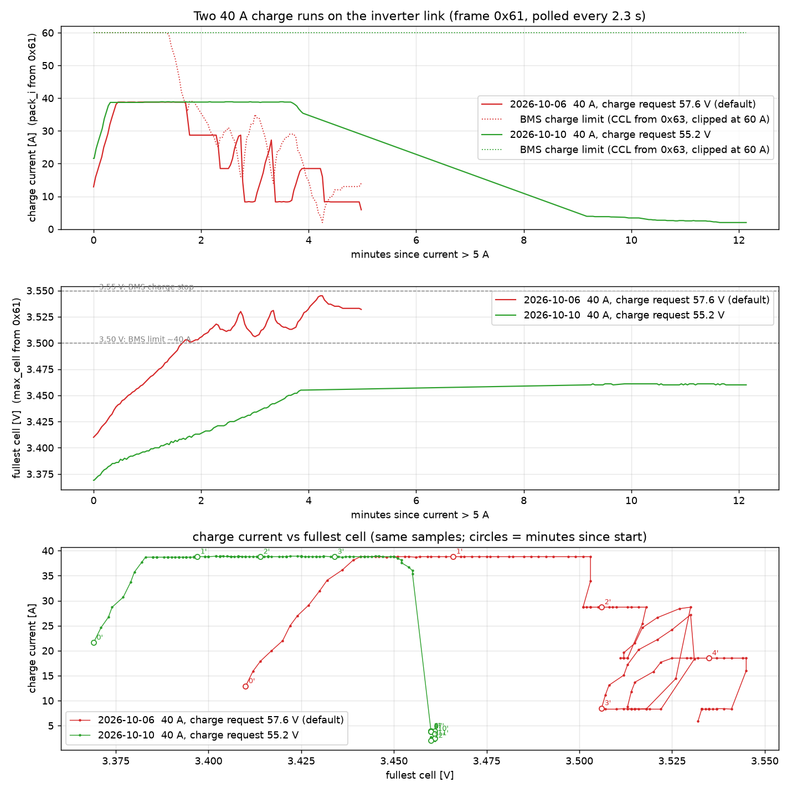
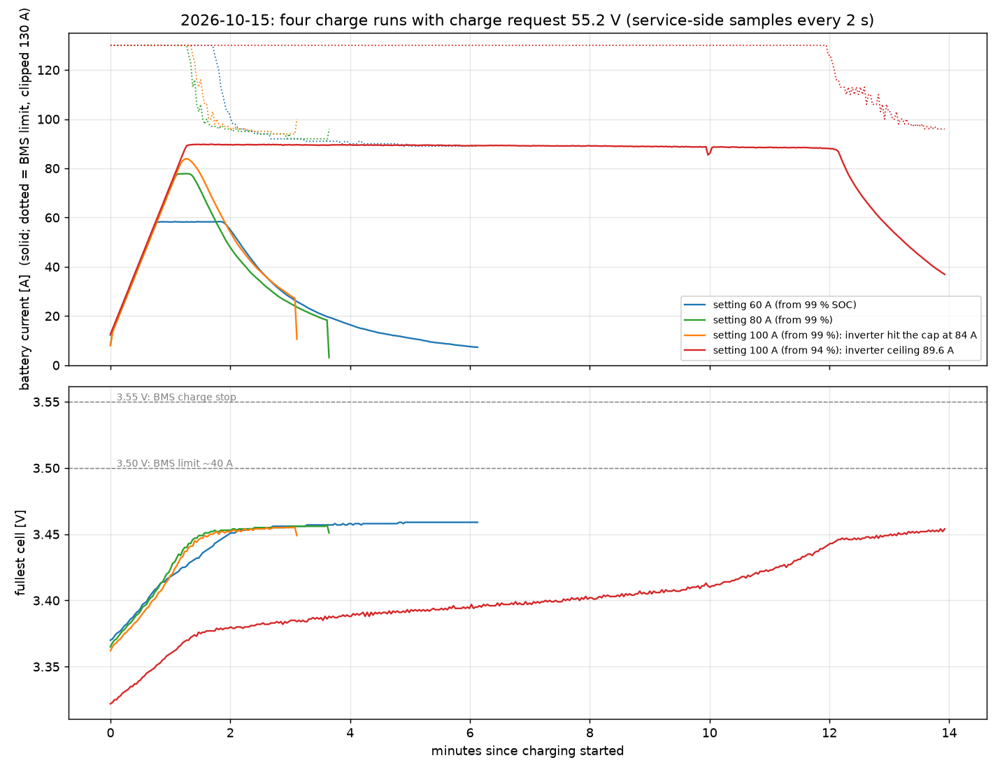

# Charge-taper investigation — results (2026-10-06 / 2026-10-10)

SAKO SUNON V 6.5 kVA (program 05 = PYL) ↔ Seplos Mason 280L 3.0 (BMS 3.0,
firmware 1.5, RS485-Pylontech mode, 16S LiFePO₄, 314 Ah). Problem as
reported: charge current near 100 % SOC rebounds (e.g. 40 → 6 → 32 → 0 A,
OV warning; at 100 A an error state on the battery).

Plan and hypotheses: `CHARGE-TAPER-PLAN.md`. Tool usage: `USAGE.md`.
All captures: `captures/taper/` (git-ignored).

## 1. Summary

1. The rebound is a control-loop interaction between a BMS whose charge
   limit follows the fullest cell voltage instantly and an inverter that
   follows that limit late, in 10 A steps, and climbs back as soon as the
   limit rises. It is not caused by the cable, the protocol, or our tools.
2. The dangerous part is the end: the inverter keeps charging for 14–35 s
   after the BMS says "stop", and cannot go below ~10 A. At 60 A this drove
   the fullest cell to 3.625 V and raised a battery alert.
3. Root cause of the end-phase: the BMS requests a charge voltage of
   57.6 V (3.60 V/cell), so the inverter never reaches its own
   constant-voltage phase and everything hangs on the current-limit
   requests it follows badly.
4. **Fix, verified on 2026-10-10:** Seplos setting 102 "Charging request
   voltage" 57.6 → **55.2 V**. At 40 A the inverter then held the pack at
   55.1–55.2 V and tapered the current by itself (39 → 2 A, smoothly) while
   the BMS limit stayed at 86–94 A; fullest cell flat at 3.460 V, no alarm,
   no seesaw.
5. **Higher currents verified 2026-10-15 (section 7):** 60 A, 80 A and the
   inverter's own maximum (89.6 A, setting 100 A) all reach the voltage cap
   without a single BMS cut-back request; smallest margin to the BMS limit
   28 A; fullest cell never above 3.46 V. Recommended everyday setting: 80 A.

## 2. Measured behaviour (unmodified system)

### 2.1 Seplos side
- Polled by the SAKO with VER 20, ADR 0x12, commands 0x61 → 0x62 → 0x63,
  cycle 2.26 s; replies after 130 / 37 / 47 ms.
- **Charge current limit (CCL) is a memoryless function of the highest
  cell voltage** (identical when charging or resting, no hysteresis):

  | fullest cell | CCL |
  |---|---|
  | < 3.425 V | 180 A |
  | 3.45 V | ~100 A |
  | 3.50 V | ~40 A |
  | 3.545 V | ~2 A |
  | ≥ 3.548 V | 0 A, charge-enable off, CVL 57.6 → 55.9 V (latched) |

  This matches Seplos' own description of firmware 1.5 (taper from 3.42 V,
  0 A at 3.55 V; resume when min cell < 3.32 V, SOC < 96 %, or discharge
  > 3 A for 2 min). The 3.42/3.55 thresholds appear as fixed constants in
  the firmware image and are not settings.
- The alarm frame (0x62) stayed all-zero in every capture, including while
  the battery display showed WARN / OV-WARN. The inverter is only told
  "do not charge" (CCL 0, charge-enable bit), never the warning itself.
- Charge voltage sent (CVL): 57.6 V normally (= setting 102, which
  defaults to the pack over-voltage protection value); 55.9 V right after
  the forced stop; **56.3 V in the latched "charge finished" state** (this
  value does not follow setting 102). SAKO programs 26/27 only mirror the
  received value and are locked in PYL mode.
- Pack voltage vs fullest cell was the same in the 20/40/60 A runs:
  54.6 V → 3.43 V (taper starts), 55.2 V → 3.47 V (CCL 70–80 A),
  55.5 V → 3.50 V (40 A), 55.9 V → 3.55 V (stop).

### 2.2 SAKO side
- Charge current settles only at 8.3 / 18.5 / 28.7 / 38.8 / 58.3 A for
  settings 10 / 20 / 30 / 40 / 60 A: **10 A steps, 10 A minimum** (minus
  ~1.5 A own consumption).
- Follows a falling CCL with 3–21 s lag, stepping down to the 10 A step
  below the limit; ramps up at ~1 A/s as soon as the limit exceeds the
  current.
- Ignores CCL below its 10 A floor; kept 8.4 A for 31 s at CCL 1–5 A
  (20 A run) and 28.8 A for 35 s after charge-disable (60 A run).
- On mains-on it briefly charges at its minimum step even while the BMS
  says "charge disabled" (12 s), then stops.
- Pauses polling for 8–14 s and re-runs its battery address scan
  (0x4F at ADR 02,05,04,03,02,01, VER 00) at every mains switch-over;
  the user sees code 32 ("communication failure inverter ↔ display panel")
  at those moments. Observed with the direct cable, so unrelated to our
  equipment.

### 2.3 The three unmodified runs

| run | setting | result |
|---|---|---|
| 2026-10-06 19:57 (bridge inline) | 40 A | seesaw 38.8 → 28.7 → 18.5 → 28.7 → 8.3 → 27 A …; fullest cell 3.545 V; cut off by mains-off |
| 2026-10-06 20:11 (bridge inline) | 20 A | no seesaw (only one step below); 8.4 A held against CCL 1–5 A; BMS stop at 3.548 V, inverter stopped 14 s later |
| 2026-10-06 20:55 (passive tap) | 60 A | seesaw 58 → 49 → 29 → 39 → 29 → 19 → 29 → 8.5 → 29 A; BMS stop at 3.548 V ignored for 35 s; fullest cell 3.625 V, 160 mV spread, battery alert |

Why the seesaw: each current cut lets the fullest cell's measured voltage
sag 10–20 mV (less current-induced rise, plus slow relaxation — in the
60 A run it fell 3.522 → 3.500 V over 48 s while still charging at 8.5 A),
the CCL jumps back up by 10–15 A, the inverter ramps again.

## 3. The fix and its verification (2026-10-10)

- Setting 102 written through the Seplos service socket (RS485-1/-2,
  19200, device 0) with `rsh seplos-set --port COM8 --setting 102
  --value 55.2 --apply`; read back and re-read independently.
- Recording `T1-55V2-tap-plus-service.jsonl`: tap on the inverter link +
  service monitor in one session.

| time | pack V | current | BMS limit | fullest cell |
|---|---|---|---|---|
| 18:02:16 | 55.10 | 38.8 A | 106 A | 3.447 V |
| 18:03:02 | 55.13 | 25.5 A | 91 A | 3.457 V |
| 18:05:33 | 55.14 | 7.4 A | 89 A | 3.459 V |
| 18:08:03 | 55.16 | 3.9 A | 88 A | 3.460 V |
| 18:10:34 | 55.16 | 2.1 A | 88 A | 3.460 V |

No alarm or protection flag, battery mode "Charge" throughout, spread
19 mV, SOC 99.8 %. Ended by a mains outage at 18:11, not by either device.

Expected at higher currents (from the voltage/cell relation): up to ~60 A
the BMS never needs to intervene before 55.2 V is reached; at 100 A its
limit drops below 100 A at ~54.9 V, so some cut-back requests (and a mild,
bounded seesaw) are possible in the last 0.3 V. 54.8 V would avoid even
that at the price of a slightly lower end-of-charge.

Both 40 A runs plotted from the inverter-link captures (frame 0x61 every
2.3 s, BMS limit from 0x63): 2026-10-06 with the 57.6 V default (red,
19:57–20:02, ended by mains-off) and 2026-10-10 with 55.2 V (green,
17:58–18:10, ended by the outage). The 10-10 run starts from a lower cell
voltage because the latch had just been cleared by a 95 A discharge.
Plot script: `tools/plot-40A-runs.py`.

## 4. Open points / next steps

1. ~~Repeat with the fix at 60 A, then 80 A, then 100 A~~ — done 2026-10-15,
   section 7.
2. Watch how a charge ends by itself with 55.2 V (float / "full" handling
   by both devices) — the 40 A run was interrupted by the outage.
3. The cell that ran ahead on 2026-10-06 (160 mV spread at the top) did not
   show on 2026-10-10 (19 mV); keep an eye on the per-cell peaks in
   `.service.csv`.
4. Our inline bridge stopped the inverter from inverting on battery (user
   test 2026-10-06); cause unknown, logs show only a ≤10 ms reply delay and
   no data differences. Monitoring is done with a passive tap since; the
   bridge is needed only for Phase 2, which the voltage fix may make
   unnecessary.
5. Waveshare USB drop-outs under heavy inverter load (ClearCommError,
   auto-reopened; one 5-min gap). The FTDI Seplos adapter on the service
   side had none — consider swapping roles for long recordings.

## 5. Tooling built for this (all in `rsh`)

`timeline` (pairing, decoded series, events, findings, CSV/PNG),
one-keypress markers, `--quiet` bench mode, bridge liveness guard,
Seplos service socket: `discover` (auto-detects it, prints all 106
settings by name), `seplos-set` (guarded write of 102/103), `seplos-monitor`
and `sniff --service` (cells, flags, charge switch, balancing, settings
changes, merged into `timeline` with `.service.csv`). Verified against the
real pack on 2026-10-10.

## 6. Supported charge current with the 55.2 V setting (inferred from the recordings)

Measured, all four runs (bulk phase, current within 2 A of the plateau):

| pack voltage | 2026-10-06 20 A | 2026-10-06 40 A | 2026-10-06 60 A | 2026-10-10 40 A |
|---|---|---|---|---|
| 55.0 V: fullest cell / spread / BMS limit | – | 3.458 V / 42 mV / 90 A | 3.455 V / 36 mV / 95 A | 3.446 V / 14 mV / 116 A |
| 55.2 V (10-10: 55.17 V in CV) | 3.476 V / 52 mV / 70 A | 3.476 V / 50 mV / 70 A | 3.471 V / 42 mV / 75 A | 3.461 V / 19 mV / 86 A |

1. At a given pack voltage the fullest cell does not depend on the current
   (18.5–58.3 A: within 5 mV); it depends on the cell spread, which was
   42–52 mV on 10-06 and 14–19 mV on 10-10.
2. The BMS limit as a function of the fullest cell (pooled, 5 mV bins):
   3.425 V 180 A · 3.44 V 134 A · 3.45 V 100 A · 3.46 V 86 A · 3.47 V 78 A ·
   3.48 V 64 A · 3.50 V 40 A · 3.52 V 24 A · 3.54 V 8 A.
3. Hence the BMS limit at the 55.2 V target is **70–75 A (10-06 balance
   state) or 86 A (10-10 state)**. An inverter setting below that reaches
   the target without any cut-back request and tapers in the inverter's
   constant-voltage mode (as seen at 40 A on 10-10).
4. Settings above that get cut-back requests shortly before the target:
   at 100 A from pack 55.06 V (10-10) / 54.95 V (10-06), at 120 A from
   54.96 / 54.86 V. The pack is still capped at 55.2 V, where the fullest
   cell stays at 3.46–3.48 V whatever the current, i.e. below the 3.50 V
   alarm and the 3.55 V stop. The inverter's step behaviour when a cut-back
   request and its own voltage regulation coincide has not been recorded.
5. Hard limits that are facts, not inferences: Mason 280L spec rated
   charge current 100 A @ 25 °C (200 A max); Seplos setting 103 = 180 A
   (largest limit it will ever send); charge over-current alarm/protection
   205/210 A.

Conclusion: **70 A is supported without any BMS intervention in both
observed balance states; 80 A in the 10-10 state (margin 7 A); 90–100 A
only with brief cut-back requests in the last ~0.15 V before the target,
bounded by the voltage cap; above 100 A the pack's own rating is the
limit.** The supported current moves with the cell spread: if the spread
grows back to 50 mV, the no-intervention limit falls to ~70 A.

## 7. 60 / 80 / 100 A with the 55.2 V setting (2026-10-15)

Same setup (`rsh sniff --ch1 COM5 --service COM8 --quiet`, one session
`T2-60A-tap-plus-service.jsonl`; analysed snapshot `T2-runs-snapshot-2031`).
Each run: discharge with house loads (50–97 A) until the fullest cell read
≈3.33 V under load, then mains on. Inverter program 02 = setting below,
program 11 (max utility charge current) = 100 A, program 02 maximum 120 A.

| setting | start SOC | plateau | cap engaged (battery-side V, time) | BMS limit then | smallest margin limit − current | fullest cell peak | spread | flags |
|---|---|---|---|---|---|---|---|---|
| 60 A | 99.0 % | 58.4 A, 74 s | 55.06 V, 19:39:11 | 100 A | 44 A | 3.459 V | 22 mV | none |
| 80 A | 99.0 % | 77.8 A, 20 s | 55.02 V, 19:49:29 | 106 A | 30 A | 3.457 V | 20 mV | none |
| 100 A | 98.9 % | none: cap hit at 83.9 A while still ramping | 54.98 V, 19:57:31 | 116 A | 29 A | 3.455 V | 19 mV | none |
| 100 A | 93.7 % | 89.6 → 88.2 A, 10.5 min | 55.01 V, 20:30:20 | 116 A | 28 A | 3.454 V | 23 mV | none |

Observations (all measured):

1. **No cut-back request in any run.** The BMS limit never came closer than
   28 A to the delivered current; the inverter's own voltage regulation took
   over first every time and tapered the current smoothly (see chart).
2. **The cap engages at 54.9–55.06 V on the battery side, not 55.2 V,** and
   earlier the higher the current (55.06 V at 55 A, 55.02 V at 74 A,
   54.98 V at 80 A, 55.01 V at 87 A). Consistent with a resistance of
   ~3 mΩ between inverter terminals and battery (cables, breaker, BMS):
   the inverter sees 55.2 V while the battery is 0.15–0.3 V lower. This
   works in our favour: the fullest cell is still at 3.44–3.45 V when the
   cap engages, and it settles at 3.455–3.46 V, below the 3.50 V alarm.
3. **The inverter's ceiling is 89.6 A** (setting 100 A, programs 02 = 120 A
   and 11 = 100 A): plateau 89.8 A at the start drifting to 88.2 A after
   10 min. Cause not identified (spec sheet says AC charge max 100 A at
   230 Vac). All lower settings delivered setting − 1.5…2.2 A as before.
4. BMS limit vs fullest cell today: 180 A below 3.425 V, 166 A at 3.430,
   133 A at 3.440, 116 A at 3.445, 100 A at 3.449–3.451, 96–98 A at
   3.452–3.453 (same curve as on 10-06/10-10, 5 mV bins).
5. Battery warnings/protections: none in 65 min; modes only
   Charge/Discharge/Standby. Inverter code 32 seen by the user at ≈19:57
   during the 100 A ramp — no polling pause on the link at that time
   (gaps only at the mains switch-overs 19:43:29 and 19:51:33), so the code
   is not accompanied by a BMS-link re-init this time.
6. Tooling: Waveshare tap (COM5) had 10 USB drop-outs, all auto-reopened,
   traced by the user to a loose/damaged USB cable (touching it triggers
   them); one 140 s gap during a discharge, none during the four charge
   windows. The Seplos FTDI adapter (COM8) had none, but its driver hung
   once at session start (process unkillable until the adapter was
   replugged).

**Conclusion:** with charge request 55.2 V the BMS limit is not the
limiting factor at any current this inverter can deliver, in today's
balance state (top-of-charge spread 19–23 mV). 80 A is the recommended
everyday setting (margin ≥ 30 A to the limit, within the pack's 100 A
rating, and with margin even in the 50 mV-spread state of 10-06 where the
limit at 55.0 V was 90–95 A). The 100 A setting gains ~10 A at most.
Still unrecorded: a natural end of charge (float/full handling) at 55.2 V.
